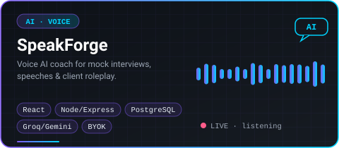
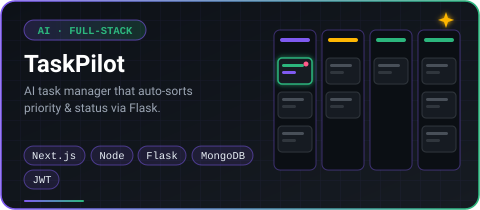
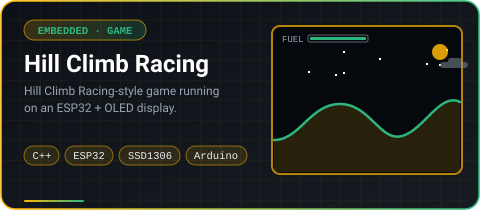
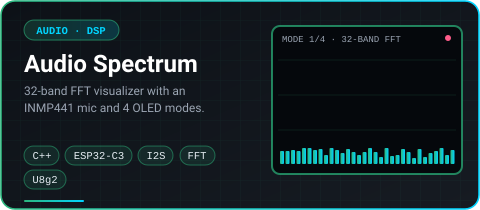
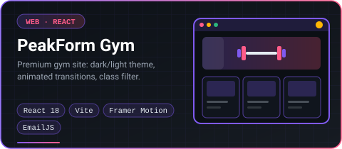

 

### 🧭 About Me

I'm a Computer Science Engineering graduate (2026) who builds full-stack products end-to-end — frontend, backend, and the AI layer that ties them together. I like shipping things that actually work: real auth, real APIs, real deployed demos, not just tutorial clones.

- 🎓 B.E. Computer Science Engineering, 2026 — **now open to full-time roles**
- 🔭 Currently building **[SpeakForge](https://github.com/abhijithk-ak/SpeakForge)** — an open-source voice AI interview & communication coach
- 🤖 Side quest: **ESP32 hardware** — companion robots, audio visualizers, and games on tiny OLED screens
- 🌱 Sharpening **DSA (Java)**, system design, and React internals
- 💬 Ask me about **Next.js, Node/Express, AI-in-the-loop product design, or ESP32 firmware**
- 🌐 See my work in more detail on my **[portfolio site](https://abhijithk-ak.github.io/abhijithk-ak/)**
- 📍 Open to relocation — full-stack / frontend / software engineering roles

### 🛠️ Tech Stack

**⚡ Languages**

  

**🎨 Frontend**

  

  

**🔧 Backend & Data**

  

**🤖 Embedded & Hardware**

  
  &nbsp;
  

**🧰 Tools & Platforms**

  

**🚀 Always building with**

### 📌 Featured Projects

<table>
  <tr>
    <td width="50%" align="center">
      
    </td>
    <td width="50%" align="center">
      
    </td>
  </tr>
  <tr>
    <td width="50%" align="center">
      
    </td>
    <td width="50%" align="center">
      
    </td>
  </tr>
  <tr>
    <td width="50%" align="center">
      
    </td>
    <td width="50%" align="center">
      
    </td>
  </tr>
</table>

▶ Other projects

 

- 🎯 **[InterviewAce](https://github.com/abhijithk-ak/InterviewAce)** — AI mock interview platform with hybrid NLP + ML scoring across 13+ technical domains, MongoDB persistence, and an analytics dashboard. *(TypeScript · Node.js · React · OpenRouter API)*
- 🔧 **[Deskbot](https://github.com/abhijithk-ak/Deskbot)** — ESP32 desktop robot with two DC motors, animated OLED eyes (FluxGarage RoboEyes), and touch-triggered autonomous movement — EVA's earlier prototype.
- 🧪 **[Indian Rainfall Prediction](https://github.com/abhijithk-ak/Indian-Rainfall-Prediction)** — Comparative ML study (Naive Bayes, Random Forest, SVM, KNN, Decision Tree) on historical rainfall data.

### 📫 Let's Connect

